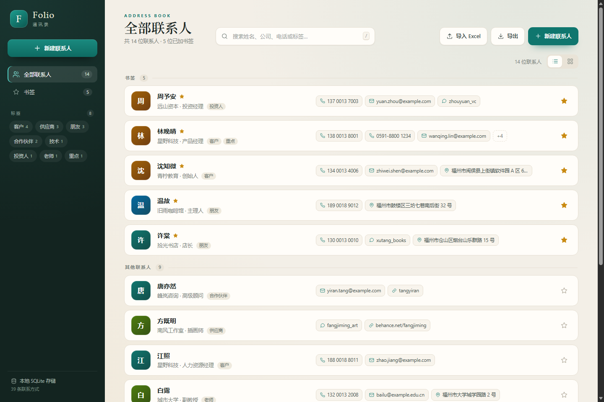
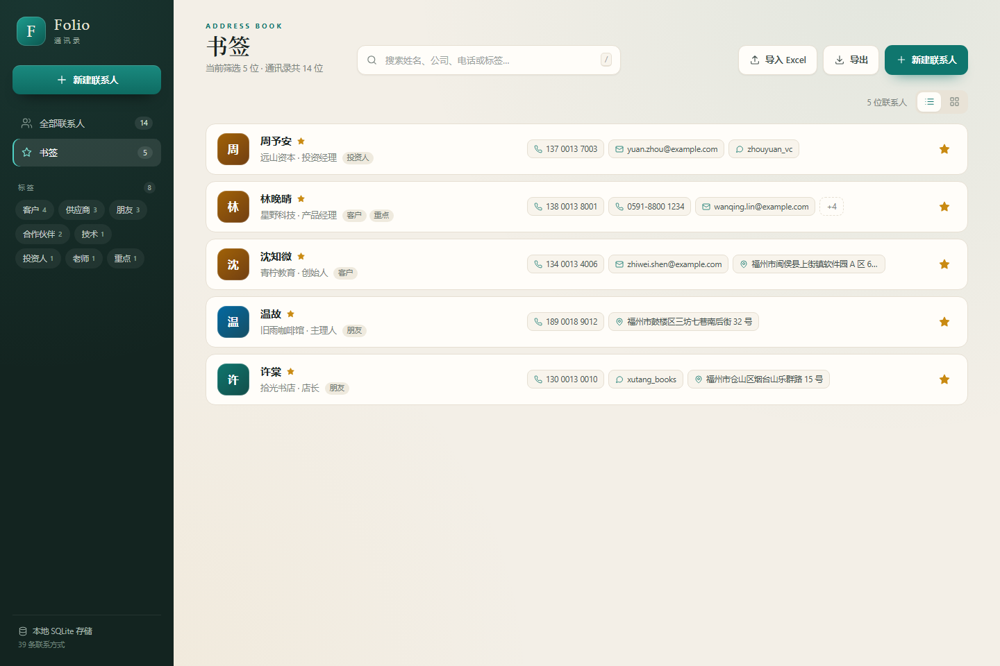
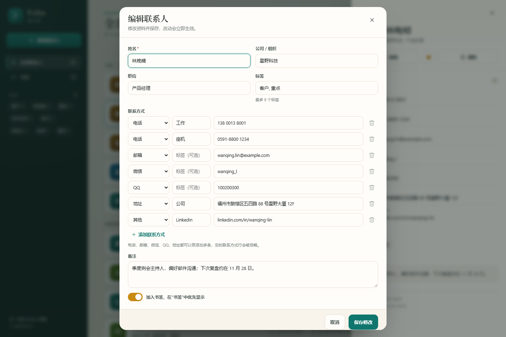
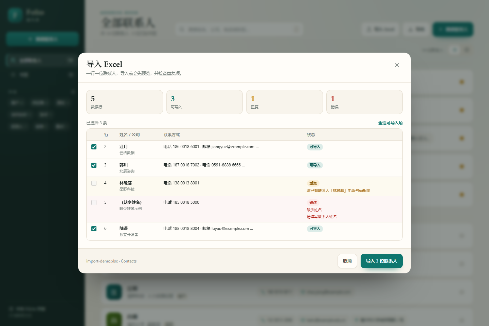
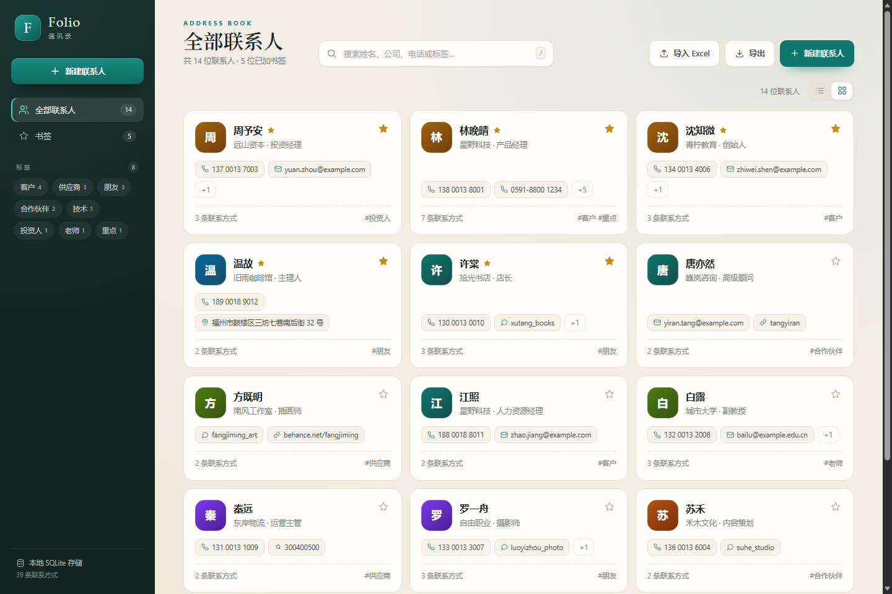
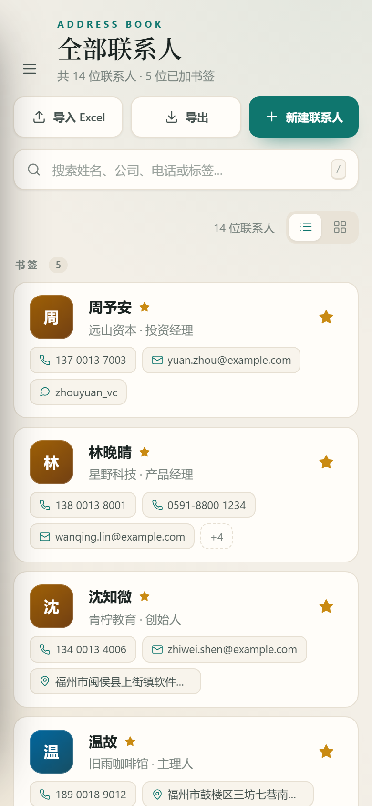

# Folio 通讯录 · Address Book

A small, dependency-light address book built for the **EE308FZ Software Engineering — Extreme Programming** assignment (2601_FZU-MU_SE).

The UI is in Chinese; the code, commit messages and documentation are in English.



## Feature checklist

| Assignment requirement | Where it is implemented |
| --- | --- |
| Bookmark contacts (25 pts) | `contacts.is_bookmarked`, `PATCH /api/contacts/<id>/bookmark`, star button on every row/card, “书签” filter, bookmarked section sorted first |
| Multiple contact methods (10 pts) | `contact_methods` 1:N table; phone / email / WeChat / QQ / address / custom (“other”) types, several of each per contact, optional labels such as 工作 or 公司 |
| Excel import (25 pts) | `POST /api/import/preview` + `POST /api/import`; header-driven parser accepts English or Chinese headers, re-ordered/extra columns, `;`-separated multi-values; preview marks rows `ok / duplicate / error`; duplicates are skipped |
| Excel export (25 pts) | `GET /api/export`; one row per contact, labelled columns (`Phone 1`, `Phone 2`, `Email 1`, …), styled header, frozen panes, auto-filter, data validation, “Read Me” sheet |
| Usable interface | Responsive single-page UI, list/grid views, search, tag filter, detail drawer, edit form, empty/loading/error states, keyboard shortcuts (`/`, `Esc`, `Ctrl/Cmd+K`) |
| Reproducible | `requirements.txt`, `run.bat` / `run.sh`, Dockerfile, sample workbooks in `sample_data/`, 24 automated tests |
| Cloud deployment (optional) | Dockerfile + [deployment guide](docs/DEPLOYMENT.md) are ready; no public instance was deployed for this submission |

## Quick start

Requirements: Python 3.10+ (tested on 3.13), pip.

```bash
# Windows
run.bat

# macOS / Linux
./run.sh
```

`run.bat` creates `.venv`, installs `requirements.txt` and starts the app on
<http://127.0.0.1:5000>. To load the demo contacts:

```bash
.venv\Scripts\python -m flask --app app seed-demo   # Windows
.venv/bin/python -m flask --app app seed-demo       # macOS / Linux
```

Manual start:

```bash
pip install -r requirements.txt
python app.py                 # http://127.0.0.1:5000
```

The SQLite database is created automatically at `instance/addressbook.sqlite3`.
Set `ADDRESSBOOK_DB` to use another path, `PORT` to change the port and
`SECRET_KEY` in production.

## Excel format

Download the template from the UI (“导入 Excel” → “下载 Excel 模板”) or
`GET /api/import/template`. A single sheet named **Contacts** is imported; the
**Read Me** sheet is ignored.

| Column | Meaning |
| --- | --- |
| `Name` | required |
| `Company`, `Job Title`, `Tags`, `Bookmarked`, `Notes` | optional; tags comma-separated, bookmark `Yes/No` |
| `Phone 1..n`, `Email 1..n`, `WeChat 1..n`, `QQ 1..n`, `Address 1..n` | one value per column; `;` splits multiple values inside a cell |
| `Other 1 Type`, `Other 1 Value` | custom methods, e.g. `LinkedIn` |

Import is header-driven: columns may be re-ordered, extra columns are ignored,
and Chinese headers (`姓名`, `电话 1`, `邮箱`, `书签`, …) are accepted too.
Before anything is written, the UI shows a preview with per-row status; rows
whose name is missing, or whose phone/e-mail already exists, are not imported.

`sample_data/` contains:

- `contacts-export-demo.xlsx` — a real export of the 14 demo contacts;
- `import-demo.xlsx` — 5 rows exercising ready / duplicate / error states;
- `import-template.xlsx` — the blank template with two examples.

## Screens

| Bookmarks | Detail drawer |
| --- | --- |
|  |  |

| Edit form with multiple methods | Import preview |
| --- | --- |
|  |  |

| Card view | Mobile |
| --- | --- |
|  |  |

## Architecture

```
address-book/
├─ app.py                  # development entry point
├─ addressbook/            # application package
│  ├─ __init__.py          # app factory, MIME fixes, CLI, error handlers
│  ├─ db.py                # SQLite connection + schema
│  ├─ repository.py        # validation and all contact/bookmark/tag queries
│  ├─ excel_io.py          # openpyxl import/export + header parser
│  ├─ api.py               # JSON API blueprint
│  └─ seed.py              # 14 fictional demo contacts
├─ templates/index.html    # single page shell
├─ static/css/style.css    # design system, responsive layout
├─ static/js/app.js        # state, rendering, interactions (no build step)
├─ tests/                  # unittest suites (API + Excel round-trips)
├─ sample_data/            # demo and template workbooks
├─ scripts/make_sample_data.py
└─ docs/                   # code standards, PSP, deployment, screenshots
```

The front end is deliberately build-free: one HTML file, one stylesheet, one
ES2020 script. This keeps the project reproducible on any lab machine.

## Data model

```
contacts (id, name, company, job_title, notes, tags, is_bookmarked,
          created_at, updated_at)
contact_methods (id, contact_id → contacts.id ON DELETE CASCADE,
                 kind, label, value, sort_order)
```

Tags are stored as `,tag1,tag2,` so exact tag filtering can use `LIKE '%,tag,%'`.
All timestamps are UTC ISO-8601 strings and rendered in local time by the browser.

## API

| Method | Path | Purpose |
| --- | --- | --- |
| GET | `/api/contacts?q=&bookmarked=1&tag=` | search / filter contacts |
| POST | `/api/contacts` | create |
| GET | `/api/contacts/<id>` | detail |
| PUT | `/api/contacts/<id>` | update (methods are replaced atomically) |
| DELETE | `/api/contacts/<id>` | delete |
| PATCH | `/api/contacts/<id>/bookmark` | toggle or set bookmark |
| GET | `/api/meta` | tags + counts |
| GET | `/api/export` | download `.xlsx` (honours current filters) |
| GET | `/api/import/template` | download template |
| POST | `/api/import/preview` | parse upload, validate, detect duplicates |
| POST | `/api/import` | commit selected preview rows |
| GET | `/api/health` | health check for deployment |

Validation errors use `{"error": {"message": "...", "fields": {...}}}` with
HTTP 400. Uploads are limited to 8 MB and 1000 rows.

## Tests

```bash
python -m unittest discover -s tests -v
```

24 tests cover validation, CRUD, bookmark toggling/filtering, tag aggregation,
multi-method ordering and de-duplication, Excel export layout, round-trip
export → import, Chinese headers, multi-value cells, duplicate detection and
error reporting.

## Design notes

- **Bookmarks are part of the contact record**, not a separate join table: one
  boolean is enough, and it lets list queries sort bookmarked contacts first
  without an extra query.
- **Contact methods are a separate table** so a contact can have any number of
  phones, e-mails or custom methods while the contact row stays small; the API
  replaces the whole set on update, which keeps ordering deterministic.
- **Excel is validated before it touches the database.** Parsing produces a
  preview; the commit endpoint re-validates every row, so a stale or tampered
  preview cannot insert invalid data.
- **No HTML from user data.** The UI renders contact values through an escape
  helper or `textContent`; the server never returns HTML.
- **SQL is parameterised everywhere**, and `PRAGMA foreign_keys = ON` keeps
  methods consistent when a contact is deleted.

## Known limitations

- Single-user local app: there is no login or multi-tenant separation. Deploy
  it as a personal/intranet tool or add authentication before exposing it.
- SQLite is perfect for a course project but serialises writes; for a large
  multi-user deployment switch to PostgreSQL.
- Import supports `.xlsx` only (not legacy `.xls`), and expects one sheet.
- The demo people, phone numbers and addresses are fictional.

## Documentation

- [Code standards](docs/CODE_STANDARDS.md)
- [PSP tables](docs/PSP.md)
- [Git workflow](docs/GIT_WORKFLOW.md)
- [Deployment guide](docs/DEPLOYMENT.md)
- [Demo script](docs/DEMO_SCRIPT.md)

## Team

Replace these placeholders before submission.

| Member | Student ID | GitHub | Main responsibility |
| --- | --- | --- | --- |
| Member A (TODO) | TODO | TODO | backend, database, Excel engine, tests |
| Member B (TODO) | TODO | TODO | UI/UX, interactions, documentation, demo |

Course: [2601_FZU-MU_SE](https://bbs.csdn.net/forums/2601_MU_SE_FZU) · Assignment:
[Extreme Programming](https://bbs.csdn.net/topics/620593436)